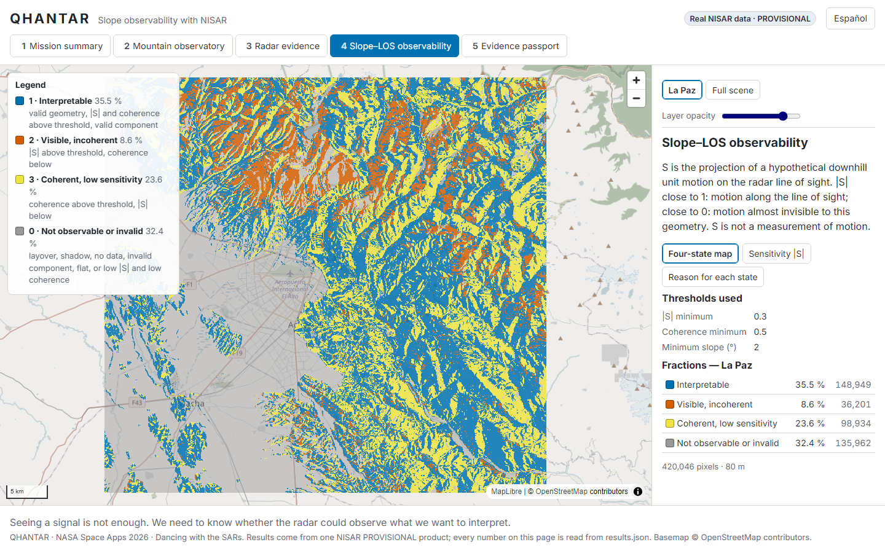

# QHANTAR

**Where is a NISAR interferogram interpretable for downhill slope motion?**
NASA Space Apps Challenge 2026 · challenge *Dancing with the SARs* · case study: La Paz, Bolivia.

QHANTAR takes one real NISAR L2 GUNW product, crosses it with a DEM, and labels every pixel with
one of four states:

| State | Meaning |
| --- | --- |
| 1 · Interpretable | valid geometry, \|S\| ≥ 0.3 **and** coherence ≥ 0.5, valid connected component |
| 2 · Visible, incoherent | \|S\| ≥ 0.3 but coherence < 0.5 |
| 3 · Coherent, low sensitivity | coherence ≥ 0.5 but \|S\| < 0.3 |
| 0 · Not observable or invalid | layover, shadow, no data, invalid component, flat, or low \|S\| and low coherence |

`S = u_slope · u_LOS` is the projection of a hypothetical downhill unit motion on the radar line
of sight. It uses the **native LOS vectors of the GUNW** and the **coherence and connected components
measured in that pair**. Thresholds are parameters, not constants. Phase, coherence, sensitivity
and masks are kept as separate layers and never combined into one score.

### What QHANTAR is not

It does not predict or detect landslides, does not compute a risk index, does not measure
displacement from S, does not convert coherence into displacement, and does not recover 3-D motion
from a single line of sight. Phase is shown in radians, never as displacement. A single 12-day pair
is not a detector of slow landslides: 5 cm/year is about 1.6 mm in 12 days.

### Prior work

The relation between slope, aspect and radar geometry is not new. QHANTAR builds on the R-index
and visibility analysis of Notti et al. (2010) and on the world-wide InSAR sensitivity index of
van Natijne et al. (2022). What QHANTAR does is apply that idea *a posteriori* to one specific NISAR
GUNW pair, with the product's own LOS vectors and its measured quality, as a reproducible four-state
classification. This is a differentiation hypothesis, not a claim of novelty.

## Results on the La Paz scene

Product: `NISAR_L2_PR_GUNW_032_118_A_169_033_2000_SH_20261008T102402_20261008T102436_20261020T102402_20261020T102436_P05023_N_F_J_001`
— ascending, left-looking, track 118, frame 169, reference 2026-10-08, secondary 2026-10-20, HH,
CRID **P05023, PROVISIONAL**, DOI [10.5067/NIL2GUNW-P1](https://doi.org/10.5067/NIL2GUNW-P1),
processed 2026-10-22T06:53:28 UTC, source NASA/JPL via ASF DAAC. Grid EPSG:32719, 80 m, 4023 × 4149.
ASF documents a P05023 timestamp issue that can cause decorrelation (fixed in P05036); no P05036
GUNW existed over La Paz on 2026-11-14.

Parameters: `s_min = 0.3`, `coh_min = 0.5`, `slope_min_deg = 2`.

| State | Radar footprint (8,972,101 px) | La Paz crop (420,046 px) |
| --- | ---: | ---: |
| 1 · Interpretable | 37.9 % | 35.5 % |
| 2 · Visible, incoherent | 3.9 % | 8.6 % |
| 3 · Coherent, low sensitivity | 19.7 % | 23.6 % |
| 0 · Not observable or invalid | 38.5 % | 32.4 % |

Most state-0 pixels are flat terrain (30.3 % of the footprint, 29.9 % of the La Paz crop, largely the
El Alto altiplano), not radar failures. Layover is 0.60 % and shadow 0.01 % of the footprint.
Median coherence of valid pixels: 0.737; median \|S\|: 0.456.

**H1** (layover/shadow pixels show lower coherence and more invalid components than geometrically
valid pixels): **supported in this scene**, with a confound.

| Group | Pixels | Median coherence | Component 0 |
| --- | ---: | ---: | ---: |
| Layover or shadow | 54,612 | 0.557 | 20.2 % |
| Geometrically valid | 8,561,452 | 0.738 | 2.5 % |
| Context: valid, slope ≥ 30° | 643,428 | 0.602 | 15.7 % |

Part of the difference is a steep-slope effect; see [`docs/validation-h1.md`](docs/validation-h1.md).
H2, H3 and H4 were not run.

Every number above is read from
[`results/T118_A_F169_20261008_20261020_P05023/results.json`](results/T118_A_F169_20261008_20261020_P05023/results.json).



## Reproduce from scratch

Requirements: Python 3.12, Node 20.11+, about 6 GB of free disk, an
[Earthdata login](https://urs.earthdata.nasa.gov/) for the NISAR file.

```bash
git clone <this repository> qhantar && cd qhantar
python -m venv .venv
source .venv/bin/activate            # Windows (Git Bash): source .venv/Scripts/activate
pip install -r requirements.txt      # exact versions used: requirements.lock.txt
pytest -q                            # 20 analytical tests

# 1. NISAR GUNW (2,281,701,376 bytes). Log in to Earthdata in a browser and download the
#    "url" of docs/search-record.json into data/raw/.

# 2. Copernicus GLO-30 DEM, 12 tiles from the open AWS bucket (no login)
mkdir -p data/raw/dem
for lat in 16 17 18 19; do for lon in 068 069 070; do
  n=Copernicus_DSM_COG_10_S${lat}_00_W${lon}_00_DEM
  curl -fsSL -o data/raw/dem/$n.tif https://copernicus-dem-30m.s3.amazonaws.com/$n/$n.tif
done; done

# 3. Process the scene, then H1
G=data/raw/NISAR_L2_PR_GUNW_032_118_A_169_033_2000_SH_20261008T102402_20261008T102436_20261020T102402_20261020T102436_P05023_N_F_J_001.h5
python scripts/process_scene.py $G data/raw/dem        # optional: --s-min --coh-min --slope-min-deg
python scripts/h1.py $G results/T118_A_F169_20261008_20261020_P05023

# 4. Web app
cd web && npm ci && npm run build && npm run preview   # http://localhost:4173
```

`python scripts/inspect_gunw.py $G docs/product-inspection.md` regenerates the product inspection
report. The processing needs about 4 GB of free RAM and takes several minutes.

## Repository

```
qhantar/engine.py        geometry, sensitivity, layover/shadow, four-state classification
tests/test_engine.py     analytical tests
scripts/                 inspect_gunw.py, process_scene.py, h1.py
results/<scene>/         results.json, La Paz GeoTIFFs (geotiff/), web PNGs (web/)
web/                     React + TypeScript + Vite + MapLibre static site (ES/EN, 5 views)
docs/                    method, conventions, decisions, status, H1, pitch, submission, AI usage, screenshots
docs/master-document.es.md   the team's foundational document (Spanish)
```

## Status

| Item | Status |
| --- | --- |
| Real NISAR GUNW downloaded with provenance | Done |
| Engine + 20 analytical tests | Done |
| Four-state map, separate evidence layers, `results.json` | Done |
| H1 | Done: supported, with a steep-slope confound |
| H2 (R-index contrast), H3 (native LOS vs heading/incidence), H4 (known active zones) | Pending |
| Web app, 5 views, ES/EN | Done |
| Validation with real users | Not done |

Evidence for each line: [`docs/STATUS.md`](docs/STATUS.md). Method: [`docs/method.md`](docs/method.md).
Decisions: [`docs/DECISIONS.md`](docs/DECISIONS.md). AI usage: [`docs/ai-usage.md`](docs/ai-usage.md).

## References

- Notti, D., Davalillo, J. C., Herrera, G., Mora, O. (2010). Assessment of the performance of X-band
  satellite radar data for landslide mapping and monitoring: Upper Tena Valley case study.
  *Natural Hazards and Earth System Sciences* 10, 1865–1875. <https://doi.org/10.5194/nhess-10-1865-2010>
- van Natijne, A. L., Bogaard, T. A., van Leijen, F. J., Hanssen, R. F., Lindenbergh, R. C. (2022).
  World-wide InSAR sensitivity index for landslide deformation tracking. *International Journal of
  Applied Earth Observation and Geoinformation* 111, 102829. <https://doi.org/10.1016/j.jag.2022.102829>
- NISAR L2 Geocoded Unwrapped Interferogram (GUNW), provisional. NASA/JPL, distributed by ASF DAAC.
  <https://doi.org/10.5067/NIL2GUNW-P1>
- Copernicus DEM GLO-30, © DLR e.V. 2010–2014 and © Airbus Defence and Space GmbH 2014–2018, provided
  under COPERNICUS by the European Union and ESA.
- Basemap © OpenStreetMap contributors.

## License

MIT, see [`LICENSE`](LICENSE).
